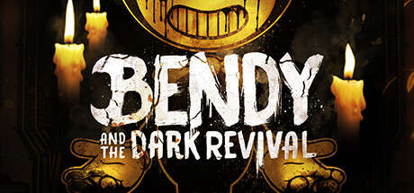

**Bendy and the Dark Revival continues the ink-drenched survival horror following Audrey fighting through the twisted cartoon studio ruled by ink demon Bendy. Features improved movement and combat over the original and a deeper story about the studio's dark history.**

---

## 📖 About

Bendy and the Dark Revival continues the ink-drenched survival horror following Audrey fighting through the twisted cartoon studio ruled by ink demon Bendy. Features improved movement and combat over the original and a deeper story about the studio's dark history.

## ⚠️ Problems Without Trainer

| Problem | Status |
|---------|--------|
| **Ink Creature Combat** — Projectile abilities against Searchers require managing ink resource carefully | ✅ Solved |
| **Gent Pipe Limitations** — Melee combat against groups drains limited pipe durability fast | ✅ Solved |
| **Plush Collection** — Finding all lost plushies requires very thorough environment exploration | ✅ Solved |
| **Lost One Pursuits** — Large Lost One variants in specific areas have enormous health pools | ✅ Solved |

## ✅ Solution

The **Bendy and the Dark Revival Trainer** solves all these issues by giving you complete control over the game.

## 🎯 Full Feature List

- Unlimited Resources
- God Mode / Invincibility
- Instant Skill Cooldown
- One-Hit Kill
- Freeze Game Timer
- Unlock All Items & Achievements
- Custom Speed Multiplier
- Save State Anywhere

## 🚀 Quick Start

1. **Disable Windows Defender** temporarily (trainer may trigger false positive)
2. Download the trainer from the button above
3. Launch Bendy and the Dark Revival
4. Run the trainer as Administrator
5. Activate desired cheats with hotkeys

## 💎 Free vs Paid

| Feature | Free | Pro |
|---------|------|-----|
| Basic God Mode | ✅ | ✅ |
| Unlimited Resources | ✅ | ✅ |
| All Advanced Cheats | ❌ | ✅ |
| Auto-Updates | ❌ | ✅ |
| Priority Support | ❌ | ✅ |

## 💻 Requirements

- Windows 10/11 (64-bit)
- Bendy and the Dark Revival (any version)
- .NET Framework 4.8+
- DirectX 11+

## 🍎 macOS

macOS users can use our alternative tool:

## ⚖️ Legal

This trainer is for educational and single-player use only. Use responsibly.

---

